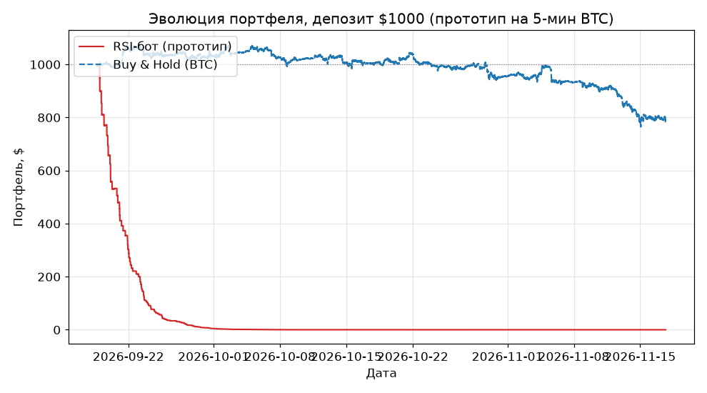
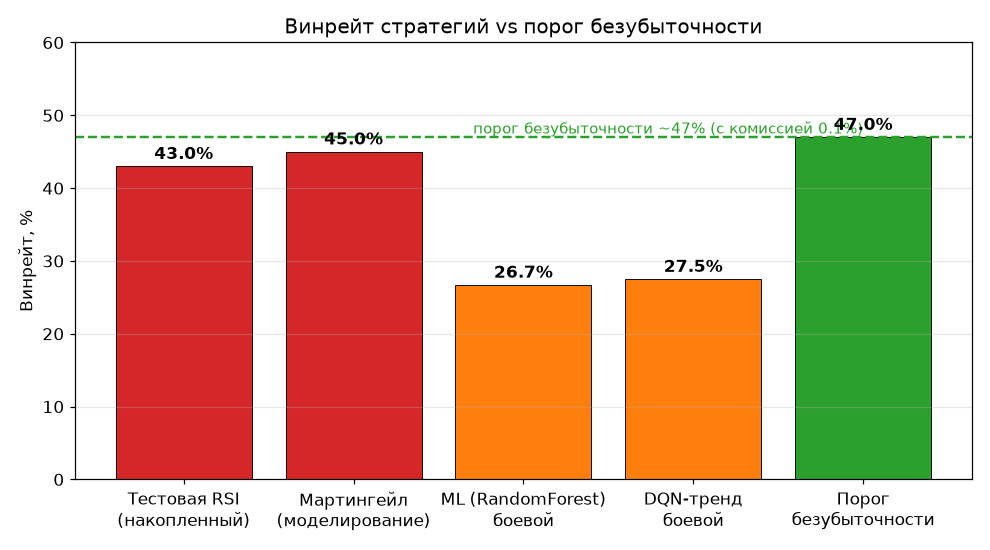
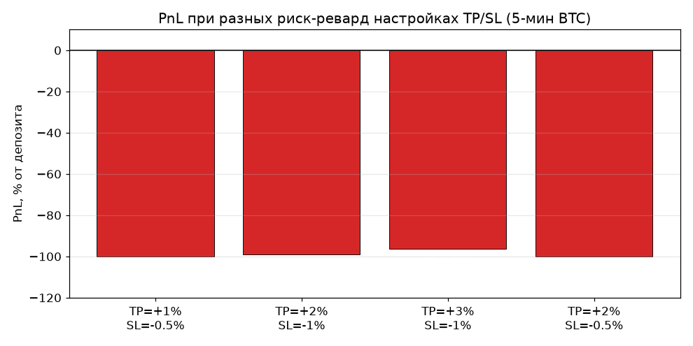

# Крипто-трейдинг бот (DRL)

Экспериментальный бот для алгоритмической торговли криптовалютой на базе обученного с подкреплением (Deep Reinforcement Learning, DRL) агента с нейросетями CNN-LSTM и алгоритмом Proximal Policy Optimization (PPO).

> **⚠️ Статус проекта: закрыт.** Это исследовательский прототип, тестирование которого показало убыточность
> направленной торговли на микродепозите по 5-минутным свечам BTC. Итоги — в [РЕЗУЛЬТАТЫ_ТЕСТИРОВАНИЯ.md](./РЕЗУЛЬТАТЫ_ТЕСТИРОВАНИЯ.md).

## 📋 Обзор

Проект реализует полную систему торговли на основе DRL, опираясь на исследование
«Automated Cryptocurrency Trading Bot Implementing DRL». Система использует:

- **Нейросети CNN-LSTM** для обработки временных рядов рыночных данных
- **Алгоритм PPO** для стабильной оптимизации политики
- **Технические индикаторы** (RSI, ATR, OBV) для инженерии признаков
- **Собственное RL-окружение** для симуляции торговли криптовалютой
- **Интеграцию с биржей Bybit** (API v5, подпись HMAC-SHA256)
- **Отчёты в Telegram** (Telegram Bot API)

## 🚀 Возможности

- **Получение данных в реальном времени**: загрузка данных криптовалют с Bybit (свечи)
- **Технический анализ**: расчёт индикаторов RSI, ATR, OBV
- **RL-окружение**: кастомное Gymnasium-окружение с действиями Buy/Hold/Sell
- **Нейросети глубокого обучения**: архитектура CNN-LSTM для actor и critic сетей
- **Реализация PPO**: полный алгоритм PPO с клиппингом и оценкой Generalized Advantage
- **Управление рисками**: комиссии за сделку, расчёт размера позиции, отслеживание портфеля
- **Бэктест**: проверка винрейта и результативности стратегий на исторических данных
- **Уведомления в Telegram**: отчёты о сделках, состоянии портфеля и статистике

## 🏗️ Архитектура

```
Получение данных → Инженерия признаков → RL-окружение → PPO-агент → Торговые действия
        ↓                    ↓                    ↓              ↓              ↓
   Bybit v5 API      →   RSI/ATR/OBV      →   Buy/Hold/Sell →   CNN-LSTM →  Buy/Sell/Hold
```

## 📊 Технические характеристики

- **Пространство состояний**: 100 шагов × 4 признака (close, rsi, atr, obv)
- **Пространство действий**: 3 дискретных действия (Buy=1, Hold=0, Sell=2)
- **Функция награды**: изменение чистой стоимости портфеля
- **Нейросети**: CNN-LSTM, 32 фильтра/нейрона
- **Алгоритм**: PPO с клиппингом ε=0.2
- **Комиссия за сделку**: 0.1%

## 🛠️ Установка

1. **Клонировать репозиторий**:
```bash
git clone https://github.com/your-username/crypto-trading-drl.git
cd crypto-trading-drl
```

2. **Создать виртуальное окружение**:
```bash
python -m venv venv
# Windows:
venv\Scripts\activate
# macOS/Linux:
source venv/bin/activate
```

3. **Установить зависимости**:
```bash
pip install -r requirements.txt
pip install gymnasium python-telegram-bot python-dotenv
```

4. **Настроить ключи** (файл `.env`):
```bash
# Bybit API
BYBIT_API_KEY=<ключ>
BYBIT_API_SECRET=<секрет>
TESTNET=false            # true для тестовой сети

# Telegram
TELEGRAM_BOT_TOKEN=<токен бота от @BotFather>
TELEGRAM_CHAT_ID=<ID вашего чата>
```

## 📈 Использование

### 1. Загрузка данных с Bybit
```python
from src.bybit_integration import BybitDataFetcher

fetcher = BybitDataFetcher(testnet=False)  # ключи читаются из .env автоматически
btc_data = fetcher.get_recent_candles('BTCUSDT', '5', days=60)
```

### 2. Инженерия признаков
```python
from src.technical_indicators import TechnicalIndicators

ti = TechnicalIndicators()
data_with_indicators = ti.add_technical_indicators(btc_data)
features = ti.prepare_features_for_model(data_with_indicators)
```

### 3. Обучение
```python
from src.trading_env import CryptoTradingEnv
from src.neural_networks import PPOAgent

env = CryptoTradingEnv(data_with_indicators)
agent = PPOAgent()
# далее — цикл обучения
```

### 4. Тестовый прогон с оценкой винрейта
```bash
python trade_runner.py   # цикл прогонов + отчёты в Telegram (RUN_HOURS=8)
```

## 📁 Структура проекта

```
crypto-trading-drl/
├── src/
│   ├── __init__.py
│   ├── bybit_integration.py     # Интеграция с Bybit API v5 (HMAC)
│   ├── telegram_reporter.py     # Отчёты в Telegram (requests)
│   ├── data_fetcher.py          # Загрузка данных (CryptoCompare, устар.)
│   ├── technical_indicators.py  # RSI, ATR, OBV
│   ├── trading_env.py           # Gymnasium RL-окружение
│   ├── neural_networks.py       # CNN-LSTM + PPO
│   └── main.py                  # Точка входа бота
├── trade_runner.py              # Тестовый прогон (винрейт)
├── test_*.py                    # Тесты компонентов
├── requirements.txt
├── .gitignore
├── README.md
└── РЕЗУЛЬТАТЫ_ТЕСТИРОВАНИЯ.md   # Итоги тестирования
```

## 🔧 Конфигурация

### API-ключи
Ключи Bybit и Telegram задаются в файле `.env` (не попадает в git).
Для приватных запросов Bybit используется подпись HMAC-SHA256.

### Гиперпараметры
Изменяются в `src/neural_networks.py`:
```python
LEARNING_RATE = 3e-4
CLIP_EPSILON = 0.2
VALUE_COEFF = 0.5
ENTROPY_COEFF = 0.01
```

## 📊 Метрики производительности

Система отслеживает:
- **Чистую стоимость** портфеля со временем
- **Коэффициент Шарпа** — доходность с поправкой на риск
- **Максимальную просадку** — наибольшее снижение от пика
- **Винрейт** — долю прибыльных сделок
- **Общую доходность** — суммарную результативность портфеля

## 🧪 Тестирование

Запуск отдельных компонентов:
```bash
# Загрузка данных
python test_data_fetcher.py

# Технические индикаторы
python test_technical_indicators.py

# Торговое окружение
python test_trading_env.py

# Нейросети
python test_neural_networks.py
```

## 📈 Результаты

> **Важно:** по итогам тестирования на реальных данных (см. `РЕЗУЛЬТАТЫ_ТЕСТИРОВАНИЯ.md`)
> направленная торговля на 5-минутных свечах BTC с микродепозитом оказалась **убыточной**
> (винрейт 27–43% при пороге безубыточности ~47%+ с учётом комиссий). Проект закрыт.

### Эволюция портфеля (RSI-прототип vs Buy & Hold)



### Винрейт стратегий vs порог безубыточности



### PnL при разных настройках риск-реварда (TP/SL)



*Графики построены на реальных данных Bybit (BTCUSDT, 5-мин, 60 дней). Итоги и разбор — в `РЕЗУЛЬТАТЫ_ТЕСТИРОВАНИЯ.md`.*

## 🔒 Безопасность и риски

- **Сначала бумажная торговля**: тестируйте на симуляции до реальных сделок
- **Управление рисками**: используйте стоп-лоссы и контроль размера позиции
- **Безопасность API**: держите ключи в переменных окружения (`.env`)
- **Валидация данных**: проверяйте целостность данных перед обучением

## 🤝 Вклад в проект

1. Сделайте форк репозитория
2. Создайте ветку под фичу
3. Внесите изменения
4. Добавьте тесты для новых функций
5. Отправьте pull request

## 📜 Лицензия

Проект распространяется по **лицензии MIT** — см. файл [LICENSE](./LICENSE).

## 🤝 Вклад

Как присоединиться к исследованию, что проверять дальше (старшие таймфреймы, грид/маркетмейкинг, риск-ревард)
и правила форков — в [CONTRIBUTING.md](./CONTRIBUTING.md).

## ⚠️ Отказ от ответственности

Это исследовательская реализация в учебных целях. Криптовалютная торговля сопряжена
со значительным риском потери средств. Всегда проводите собственное исследование
и никогда не вкладывайте больше, чем готовы потерять.

## 📚 Ссылки

- Исследование: «Automated Cryptocurrency Trading Bot Implementing DRL»
- Алгоритм PPO: Schulman et al. (2017)
- OpenAI Gym: Brockman et al. (2016)
- PyTorch: Paszke et al. (2019)
- Bybit API v5: https://bybit-exchange.github.io/docs/v5/

## 🆘 Поддержка

По вопросам:
1. Смотрите тест-скрипты как примеры
2. Изучите docstring в каждом модуле
3. Откройте issue на GitHub

---

**Удачной торговли! 🚀📈**